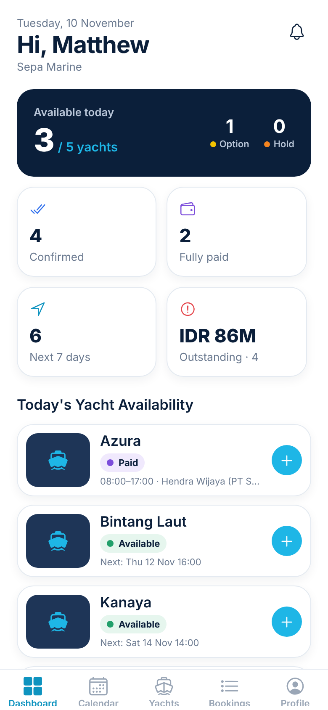
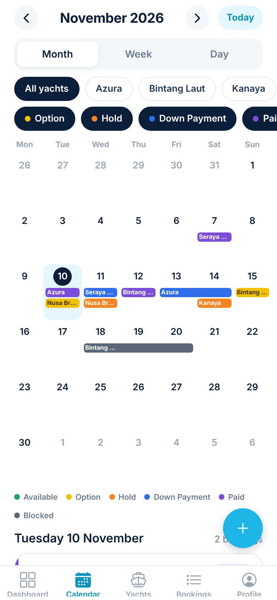
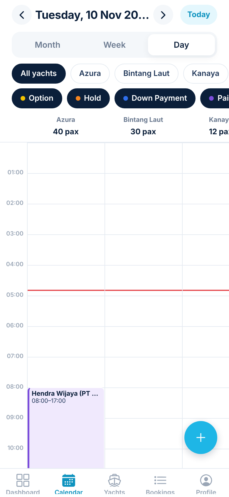
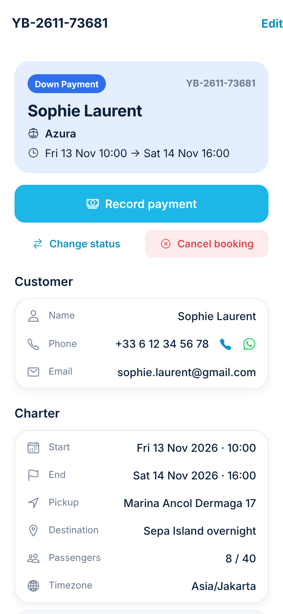
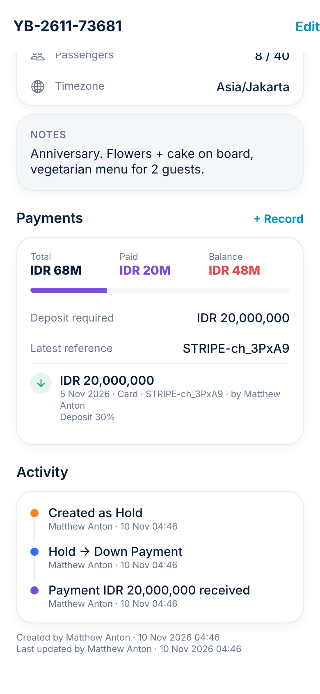

# YachtOps — Yacht Availability & Booking Management

A mobile app (iOS + Android) for yacht owners, fleet operators and charter managers. Each owner registers their yachts, manages bookings through five statuses, and sees availability on a calendar that stays in sync across the whole team.

| Dashboard | Calendar | All-yachts day view | Booking | Payments & audit |
|---|---|---|---|---|
|  |  |  |  |  |

---

## Architecture

```
yacht-booking/
├── mobile/                 Expo SDK 58 · React Native 0.88 · TypeScript · expo-router
│   └── src/
│       ├── app/            Screens (file-based routes)
│       │   ├── (auth)/     sign-in, sign-up, verify-email, forgot-password
│       │   └── (app)/      (tabs): Dashboard · Calendar · Yachts · Bookings · Profile
│       │                   booking/*, yacht/*, team, notifications, settings/*
│       ├── api/            Typed data access (Supabase / PostgREST / RPC)
│       ├── providers/      Auth session + Workspace (active org, role, permissions)
│       ├── hooks/          Realtime sync, push registration
│       ├── components/     UI kit, calendar engine, booking & yacht components
│       └── lib/            theme, timezone model, formatting, errors
└── supabase/
    ├── migrations/         Schema, RLS, triggers, RPCs, storage, realtime, cron, demo fleet
    ├── functions/          Edge functions: invite-member, push-dispatch
    └── tests/              Database test suite (66 assertions, runs on plain Postgres)
```

**Backend: Supabase** (managed Postgres + Auth + Realtime + Storage + Edge Functions). It covers every item in the technical requirements (PostgreSQL, secure auth with email verification and reset, RLS, real-time, image storage, serverless functions) without running a separate API server. **All business rules run in Postgres**, so the client can't get around them.

### Multi-tenancy & security
- **Tenant = organization** (an owner's company). Every row carries `org_id`, and **Row Level Security** on every table restricts access to members.
- **Roles**: `owner` (full access), `manager` (bookings and statuses), `viewer` (read-only). Policies enforce them; the UI only hides controls.
- `org_id` on bookings is **derived server-side from the yacht**, so a forged ID can't move a booking into another tenant.
- The payment ledger and audit log are **append-only** (UPDATE/DELETE revoked).
- Invitations are accepted **only after the invitee's email is verified**.

### Booking rules (enforced in the database)
| Rule | Mechanism |
|---|---|
| HOLD / DP / PAID / BLOCKED can never overlap on one yacht | `EXCLUDE USING gist (yacht_id =, period &&)`, which is race-proof |
| Readable conflict messages ("Azura is already on Paid (YB-2611-…)") | `BEFORE` trigger + per-yacht advisory lock |
| OPTION can't sit on a confirmed slot; multiple OPTIONs only if the org enables it | trigger, `organizations.allow_multiple_options` |
| OPTION / HOLD expire and are released to AVAILABLE automatically | `run_booking_maintenance()` via pg_cron every 5 min |
| Recording a deposit → DOWN PAYMENT; settling the balance → PAID | `payments` ledger trigger (refunds roll back to DP) |
| Payment history is never overwritten | separate `payments` table, append-only |
| Maintenance / private-use blocks | `blocked` status (owners only) |
| Full activity log with who/what/when | `booking_activity` written by triggers, including system expiries |
| Capacity, time order, expiry-in-future, inactive yachts | trigger validation |

AVAILABLE is **derived** (no active booking covers the slot), so stale "available" rows can't drift out of sync with real bookings.

### Timezones
All instants are stored as `timestamptz` (UTC). Each organization has an IANA timezone (default `Asia/Jakarta`), and every screen shows and edits times in that zone, whatever the phone's own timezone is. A broker in Singapore and a captain in Ancol see the same 09:00 departure. Dashboard "today" boundaries are also computed in the org timezone on the server. See `mobile/src/lib/datetime.ts`.

### Real-time
`useRealtimeSync` subscribes to Postgres changes (bookings, payments, yachts, members, notifications) filtered by org. Realtime applies RLS, so tenants never receive each other's events. Bursts of changes are batched into one React Query refresh, which updates every open calendar within about a second.

### Notifications
Triggers and the maintenance job write `notifications` rows for each member, filtered by that member's preferences (8 event types). The in-app inbox reads them live. The `push-dispatch` edge function delivers them through Expo Push and removes dead device tokens.

---

## Getting started

### 1. Backend (Supabase)
```bash
# Hosted: create a project at supabase.com, then
npx supabase link --project-ref <ref>
npx supabase db push                     # applies supabase/migrations
npx supabase functions deploy invite-member push-dispatch
```
Dashboard settings:
- **Auth → Providers → Email**: enable *Confirm email*.
- **Auth → URL Configuration**: add `yachtops://auth-callback` (and `exp://**` for Expo Go dev) to Redirect URLs.
- **Database → Extensions**: enable `pg_cron` before pushing (the migration schedules the job automatically if it is available).
- **Database → Webhooks**: on `INSERT` into `public.notifications`, call the `push-dispatch` function. Optional: set `PUSH_DISPATCH_SECRET` and send it as an `x-dispatch-secret` header.

Local: `npx supabase start && npx supabase db reset` (Docker required).

### 2. Mobile
```bash
cd mobile
cp .env.example .env        # EXPO_PUBLIC_SUPABASE_URL / EXPO_PUBLIC_SUPABASE_ANON_KEY
npm install
npx expo start              # then i / a, or scan with a development build
```
Remote push and native date pickers need a **development build** (`npx expo run:ios|android` or `eas build --profile development`). Set `expo.extra.eas.projectId` in `app.json` for push tokens.

### 3. Demo
1. Sign up → verify your email → sign in. A private workspace is created for you.
2. On the Dashboard tap **Load sample fleet**. This loads 5 yachts (a Phinisi, a catamaran, a motor yacht, a sport cruiser and a speedboat out of Marina Ancol and Serangan) with bookings in every status, a payment history and a maintenance block, all dated relative to today.
3. Create bookings from the calendar (tap a day, or tap an hour in Week/Day view), convert Option → Hold → record a deposit, and watch the status change.

### Tests
```bash
cd supabase/tests && ./run.sh
```
Starts a throwaway Postgres, applies every migration against a stubbed Supabase `auth` schema, and checks 66 assertions covering tenant isolation, role permissions, overlap prevention, multi-option settings, ledger → status automation, refunds, the atomic create-with-deposit rollback, invitation verification, auto-expiry, notifications and the dashboard.

Mobile: `npm run typecheck`, and `npx expo export` bundles iOS and Android.

---

## Roadmap status

**Phase 1 — Core MVP: done.** Registration, login, email verification, password reset, profiles, yacht CRUD with photos, dashboard, five statuses plus Cancelled, interactive calendar (month/week/day, per-yacht and all-yachts), conflict prevention, data separation per owner.

**Phase 2 — Operations: built.** Team invites and roles, push and in-app notifications with preferences, automatic expiry, payment ledger, activity log, maintenance blocks.

**Phase 3 — Next.** These fit the current schema without migrations that break existing data:
- *Shared availability links / broker access*: a signed token table plus a read-only RPC that returns only availability (no customer data).
- *Calendar export*: an edge function serving an ICS feed per yacht.
- *Advanced reporting*: SQL views over `bookings` and `payments` (utilisation, revenue per yacht, lead → paid conversion).
- *Subscriptions*: a `plan` column on `organizations` plus RLS-checked limits (e.g. yacht count).
- *Public inquiry form*: an anonymous RPC that creates an OPTION with rate limiting.
